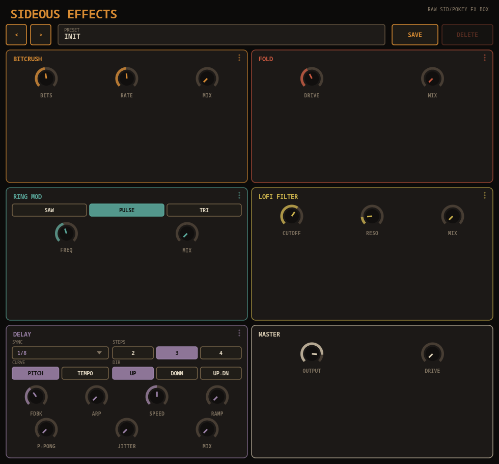

# Sideous Effects

> **⚠️ VIBE CODED SLOP.** This entire plugin — DSP, GUI — was built through
> conversational back-and-forth with an AI, not hand-engineered from a spec.
> It works, it's been tested, but go in with appropriate expectations.

A raw, chip-vibe audio effects box (VST3 / LV2 / CLAP / JACK standalone),
built on [DPF](https://github.com/DISTRHO/DPF) with a hand-drawn Cairo-based
UI — the first pure-effect plugin in the Sideous family (every sibling so
far is an instrument). Five reorderable tonal stages - Bitcrusher,
Wavefolder, Ring Modulator, Lo-fi Filter, and a tempo-synced Delay with a
deeply tunable "chip-arpeggiated" repeat mode - plus a fixed Master
drive/output stage. "Broken cassette deck" palette instead of any sibling's
brighter retro-synth or neon-chip look.



## Signal chain - drag to reorder

Bitcrusher, Wavefolder, Ring Mod, Lo-fi Filter, and Delay can be dragged by
their panel header into any order you like - grab a panel and drop it on
another cell, and everything in between shifts over to make room. Master
(Drive/Output) always runs last - it's the output gain stage, not a
reorderable block. Want the bit-crush quantization noise to be the very
last thing before output, like a real POKEY-style chip's 4-bit-per-channel
DAC? Drag BITCRUSH down onto the last cell.

Every reorderable stage has its own **Mix** knob (dry/wet blend into the
next stage in the chain), and **every Mix knob defaults to 0**, so a
freshly-loaded instance is a clean pass-through until you dial a stage in.

- **BITCRUSH** - Bits (1-16, bit-depth quantization), Rate (1-40x
  sample-and-hold downsample factor), Mix.
- **FOLD** - a wavefolder: Drive (pre-gain into a fold-back waveshaper),
  Mix.
- **RING MOD** - Wave (Saw/Pulse/Triangle carrier), Freq (20-4000Hz),
  Mix.
- **LOFI FILTER** - a resonant lowpass: Cutoff (200-15000Hz), Reso, Mix.
- **DELAY** - Sync, Steps, Curve, Direction, Feedback, Arp, Speed, Ramp,
  Ping-Pong, Jitter, Mix - see below.
- **MASTER** - Output level, Drive (post saturation stage).

## Chip-arpeggiated delay

Turning the Delay's **Arp** knob above 0 changes how the delay repeats.
Normally (Arp = 0) it's a plain fixed-lag feedback delay. With Arp > 0,
each repeat plays back at a fixed pitch for its whole length, cycling
through a repeating arpeggio instead of staying on one pitch - Arp sets the
step size in semitones. The pitched repeats feed back into the same
buffer, so Feedback and Arp compound naturally. There's no crossfading at
grain boundaries - a small click on each repeat is in-character for this
box's raw/lo-fi aesthetic, not a bug.

The shape of that arpeggio is fully tunable:

- **Sync** - tempo-locked repeat interval, Free + 16 divisions including
  dotted/triplet down to 1/128.
- **Steps** - 2, 3, or 4 taps per cycle before it repeats.
- **Curve** - **PITCH** steps equal semitones between taps (the classic
  arpeggio, but the playback *rate* compounds multiplicatively, so later
  taps speed up a lot); **TEMPO** steps equal *rate* increments instead,
  taming that acceleration - later taps stay closer in pitch to the one
  before.
- **Direction** - **UP** (ascending, resets), **DOWN** (descending),
  **UP-DN** (rises then mirrors back down before resetting - needs Steps
  ≥ 3 to read as different from UP).
- **Ping-Pong** - alternating taps favor the left/right channel; 0 stays
  centered, 1 hard-alternates.
- **Jitter** - a small random per-repeat detune (up to ±30 cents at max)
  for an analog-ish wobble instead of perfectly quantized pitches.

Two more controls change the raw *speed* each repeat plays back at, on top
of the arpeggio shape above:

- **Speed** - a flat 0.25x-4x rate multiplier applied to *every* repeat,
  even with Arp at 0 - like winding a tape player faster or slower. Stacks
  with whatever the Steps/Curve/Direction pattern already computed.
- **Ramp** - instead of a fixed rate for a repeat's whole length, the rate
  ramps up *within* that single repeat, from its start rate to
  start-rate × 2^(Ramp semitones/12) by the time it ends - each individual
  echo audibly speeds up as it plays, like a turntable gaining speed,
  independent of the between-repeat stepping. Re-derived fresh every
  repeat, so it doesn't carry over into the next one.

Hold **Shift** while dragging or scrolling the **Arp** or **Speed** knobs
to snap to whole semitone steps instead of a continuous value - useful for
landing on exact musical intervals (Arp) or exact tape-style pitch/speed
changes (Speed, snapped on the same semitone grid: 12 semitones = 2x,
24 = 4x, and so on).

## Presets

A small file-based preset library, entirely UI-side so it works identically
across every host/format including the JACK standalone: `<` / `>` step
through presets, click the name field to rename, `SAVE`/`DELETE` manage the
library. Presets are plain-text `.sdpreset` files (one `symbol=value` line
per parameter) in `~/.local/share/sideous-effects/presets` (Linux/XDG),
`~/Library/Application Support/sideous-effects/presets` (macOS), or
`%APPDATA%\sideous-effects\presets` (Windows).

Six factory presets (Telephone Crush, Robot Voice, Arcade Echo, Broken
Speaker, Tape Warble, POKEY Quantize) are seeded into that folder the first
time the UI runs with an empty library - from then on they're just ordinary
presets, editable and deletable like anything you save yourself.

## Building

```sh
git clone --recursive <repo-url>
cd sideous-effects
./install.sh --all
```

(If you already cloned without `--recursive`, run
`git submodule update --init --recursive` first.)

Built plugins land in `build/bin/`:
`sideous-effects.vst3` / `.lv2` / `.clap` / `sideous-effects` (JACK/native
standalone).
